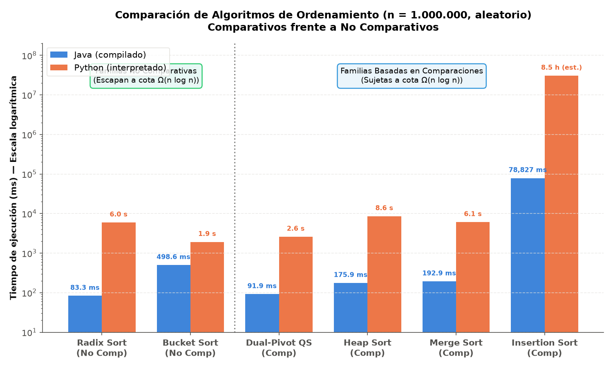
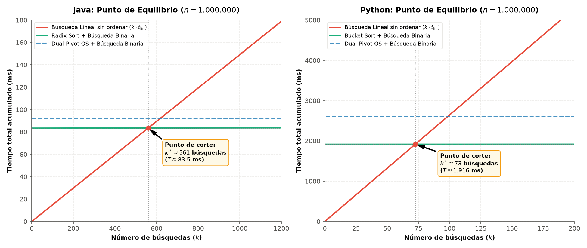

# Taller de Ordenamiento y Búsqueda: Punto 3 (Análisis Comparativo)

## 1. Comparativos frente a No Comparativos

### 1.1 Límite inferior teórico para algoritmos basados en comparaciones

En el modelo de cómputo basado en comparaciones (*Comparison Tree Model*), cualquier algoritmo de ordenamiento determina la permutación ordenada de una entrada de $n$ elementos realizando únicamente comparaciones binarias del tipo $a_i \le a_j$.

1. **Permutaciones posibles:** Para una secuencia de $n$ elementos distintos, existen exactamente $n!$ permutaciones posibles, y el algoritmo debe ser capaz de distinguir cuál de ellas corresponde al orden ascendente correcto.
2. **Estructura del árbol de decisión:** El proceso de ordenamiento puede representarse como un árbol binario de decisión donde:
   - Cada nodo interno representa una comparación entre dos elementos ($a_i : a_j$).
   - Cada rama saliente representa uno de los dos posibles desenlaces ($\le$ o $>$).
   - Cada hoja representa una permutación ordenada final.
3. **Altura del árbol y número de hojas:** Para poder ordenar cualquier entrada posible sin ambigüedad, el árbol debe contener al menos tantas hojas ($L$) como permutaciones posibles existen:
   $$L \ge n!$$
   Un árbol binario de altura $h$ tiene a lo sumo $2^h$ hojas. Por tanto:
   $$2^h \ge L \ge n! \implies h \ge \log_2(n!)$$
4. **Cota asintótica mediante aproximación de Stirling:**
   $$\ln(n!) = n \ln n - n + O(\ln n)$$
   O bien, observando que la mitad superior de los factores cumple:
   $$n! \ge \left(\frac{n}{2}\right)^{n/2} \implies \log_2(n!) \ge \frac{n}{2} \log_2\left(\frac{n}{2}\right) = \frac{n}{2}(\log_2 n - 1) = \Omega(n \log n)$$

**Conclusión teórica:** Cualquier algoritmo de ordenamiento basado en comparaciones requiere en el peor caso al menos $\lceil \log_2(n!) \rceil = \Omega(n \log n)$ comparaciones. Ningún algoritmo de este tipo (como QuickSort, Merge Sort o Heap Sort) puede tener una cota inferior asintótica menor a $\Omega(n \log n)$.

---

### 1.2 ¿Por qué Radix Sort y Bucket Sort no están sujetos a este límite?

Radix Sort y Bucket Sort **no realizan comparaciones directas** ($a_i < a_j$) para ordenar los elementos. En su lugar, explotan la **estructura digital y la representación posicional de los datos**, así como funciones matemáticas de direccionamiento directo en memoria:

- **Radix Sort (LSD):** Trata cada clave numérica como una tupla de $d$ dígitos en base $b$. Aplica sucesivamente un algoritmo de ordenamiento estable auxiliar (típicamente Counting Sort) sobre cada posición dígito por dígito, desde el dígito menos significativo hasta el más significativo. Counting Sort realiza conteo de frecuencias y cálculo de sumas acumuladas para indexar directamente las posiciones en tiempo $O(n + b)$ sin comparar elementos entre sí. Para $d$ dígitos fijos, el costo total es $O(d \cdot (n + b)) = O(n)$, logrando una cota lineal.
- **Bucket Sort:** Asume que los datos pertenecen a un intervalo conocido $[min, max]$ y divide dicho espacio en $k$ intervalos disjuntos o cubetas (*buckets*). Asigna cada elemento a su cubeta en tiempo $O(1)$ mediante una función de dispersión aritmética directa:
  $$\text{índice\_cubeta} = \left\lfloor \frac{arr[i] - min}{max - min + 1} \cdot k \right\rfloor$$
  Luego de distribuir los elementos, se ordenan individualmente las cubetas y se concatenan. Cuando los datos provienen de una distribución uniforme continua o discreta, la cantidad de elementos por cubeta sigue una distribución binomial con esperanza $E[n_i] = n/k \approx \Theta(1)$ si $k = \Theta(n)$, lo que arroja un tiempo esperado total de $O(n)$.

---

### 1.3 Comparación de tiempos medidos ($n = 1.000.000$, aleatorio)

| Algoritmo | Familia | Tipo | Java (ms) | Python (ms) | Python / Java |
|---|---|---|---|---|---|
| **Radix Sort** | Distribución (LSD) | No comparativo | **83,320 ± 9,307** | 5.951,966 ± 117,606 | 71,4× |
| **Bucket Sort** | Distribución (Cubetas) | No comparativo | 498,618 ± 128,993 | **1.915,109 ± 95,585** | 3,8× |
| **Dual-Pivot QuickSort** | Partición | Comparativo | 91,854 ± 7,004 | 2.600,673 ± 80,337 | 28,3× |
| **Heap Sort** | Selección | Comparativo | 175,949 ± 12,364 | 8.585,681 ± 503,718 | 48,8× |
| **Merge Sort** | Mezcla | Comparativo | 192,903 ± 24,911 | 6.090,020 ± 305,685 | 31,6× |
| **Insertion Sort** | Inserción | Comparativo | 78.826,821 ± 1.429,596 | 30.575.356,2 (est.) | 388× (est.) |

#### Análisis de los resultados empíricos:
1. **El más rápido en Java:** **Radix Sort** (83,32 ms) superó a todos los algoritmos comparativos, incluyendo a Dual-Pivot QuickSort (91,85 ms), Heap Sort (175,95 ms) y Merge Sort (192,90 ms). La razón radica en que Java compila a instrucciones de máquina eficientes y manipula arreglos contiguos primitivos `int[]` de 32 bits, ejecutando las 8 pasadas de Counting Sort sin incurrir en comparaciones de clave ni saltos condicionales complejos.
2. **El más rápido en Python:** **Bucket Sort** (1.915,11 ms) fue el más veloz en Python, superando a Dual-Pivot QuickSort (2.600,67 ms) y a Radix Sort (5.951,97 ms). En Python, el costo de iterar bucles en el intérprete CPython penaliza severamente a Radix Sort (que debe realizar 8 recorridos completos del millón de elementos sobre estructuras dinámicas), mientras que Bucket Sort realiza un único recorrido de dispersión y las cubetas resultantes contienen tan pocos elementos que Insertion Sort termina en muy pocas operaciones.

---

### 1.4 Supuestos sobre los datos de entrada y qué ocurriría si no se cumplen

Ambos algoritmos no comparativos logran complejidad temporal lineal $O(n)$ a expensas de imponer fuertes restricciones sobre las características de los datos de entrada:

#### Para Radix Sort:
- **Supuesto:** La longitud de las claves $d$ debe ser pequeña y constante ($d = O(1)$), independiente del tamaño $n$ del arreglo. En el taller, se utilizaron números de 8 dígitos ($d = 8$, rango $10.000.000$ a $99.999.999$).
- **¿Qué ocurre si el supuesto no se cumple?**
  - **Ejemplo con números de 16 dígitos:** Dado que la complejidad es $O(d \cdot (n + b))$, si las claves crecen a $d = 16$ dígitos, el algoritmo requiere realizar exactamente el doble de pasadas completas de Counting Sort sobre el arreglo. Por lo tanto, **el tiempo de ejecución se duplica directamente ($\approx 2\times$)**.
  - **Ejemplo con claves de longitud variable o dependientes de $n$:** Si las claves tienen una longitud proporcional a $\log_b n$ (como ocurre cuando se ordenan enteros arbitrarios en un rango $[1, n^c]$), entonces $d = \Theta(\log n)$. En este caso, la complejidad pasa a ser $O(n \log n)$, perdiendo su ventaja asintótica frente a QuickSort o Merge Sort y volviéndose frecuentemente más lenta debido al factor constante de asignación y copia en memoria auxiliar.

#### Para Bucket Sort:
- **Supuesto:** Los elementos deben estar distribuidos de manera **uniforme** a lo largo del intervalo $[min, max]$. En el taller, los números se generaron de forma pseudoaleatoria uniforme entre 10.000.000 y 99.999.999, distribuyéndose equitativamente entre las $k = 100.000$ cubetas ($\approx 10$ elementos por cubeta).
- **¿Qué ocurre si el supuesto no se cumple?**
  - **Ejemplo con valores concentrados en un rango pequeño (o distribución sesgada):** Si los datos presentan una alta concentración en un subrango específico (distribución normal con varianza estrecha, sesgo exponencial o claves repetidas masivamente), la gran mayoría de los $n$ elementos caerá en una o muy pocas cubetas.
  - Como el ordenamiento interno de cada cubeta utiliza típicamente un algoritmo cuadrático como **Insertion Sort**, si una sola cubeta concentra $m \approx n$ elementos, el tiempo de ordenamiento interno degenera a $O(m^2) \approx O(n^2)$.
  - En consecuencia, Bucket Sort **colapsa catastróficamente al peor caso cuadrático $O(n^2)$**, resultando órdenes de magnitud más lento que algoritmos comparativos robustos como Merge Sort o Heap Sort, cuya cota $O(n \log n)$ está garantizada independientemente de la distribución de las claves.

---

## 2. ¿Ordenar o no ordenar? (Punto de Equilibrio $k^*$)

### 2.1 Planteamiento y Formulación Algebraica

Se tiene un arreglo desordenado de $n = 1.000.000$ elementos y se deben realizar $k$ consultas de búsqueda. Se evalúan dos estrategias operativas:

1. **Estrategia A (Búsqueda Lineal sin ordenar):**
   No se incurre en ningún costo previo de ordenamiento ($T_{\text{prep}} = 0$). Cada una de las $k$ búsquedas se realiza secuencialmente sobre el arreglo desordenado con un tiempo individual promedio $t_{\text{lineal}}$.
   $$T_A(k) = k \cdot t_{\text{lineal}}$$

2. **Estrategia B (Ordenar previamente y aplicar Búsqueda Binaria):**
   Se paga un costo inicial único de ordenamiento $T_{\text{ordenar}}$ utilizando el algoritmo de mejor rendimiento medido. A partir de allí, cada una de las $k$ búsquedas se resuelve en tiempo logarítmico mediante Búsqueda Binaria con un tiempo individual promedio $t_{\text{binaria}}$.
   $$T_B(k) = T_{\text{ordenar}} + k \cdot t_{\text{binaria}}$$

3. **Deducción del Punto de Equilibrio (*Break-Even Point* $k^*$):**
   Resulta más conveniente ordenar el arreglo cuando el costo total de la Estrategia B es estrictamente inferior al de la Estrategia A:
   $$T_B(k) < T_A(k)$$
   $$T_{\text{ordenar}} + k \cdot t_{\text{binaria}} < k \cdot t_{\text{lineal}}$$
   $$k \cdot (t_{\text{lineal}} - t_{\text{binaria}}) > T_{\text{ordenar}}$$
   $$k > \frac{T_{\text{ordenar}}}{t_{\text{lineal}} - t_{\text{binaria}}}$$

El valor crítico exacto es:
$$k^* = \frac{T_{\text{ordenar}}}{t_{\text{lineal}} - t_{\text{binaria}}}$$
Por ser $k$ un número entero de consultas, la condición se cumple para todo:
$$k \ge \lceil k^* \rceil \quad (\text{o } \lfloor k^* \rfloor + 1 \text{ si } k^* \text{ no es entero})$$

---

### 2.2 Cálculos Numéricos con las Mediciones Reales ($n = 1.000.000$)

#### En Java:
- **Tiempos de ordenamiento:**
  - Mejor absoluto (**Radix Sort**): $T_{\text{ordenar}} = 83,320\text{ ms} = 83.320\ \mu\text{s}$
  - Mejor comparativo (**Dual-Pivot QuickSort**): $T_{\text{ordenar}} = 91,854\text{ ms} = 91.854\ \mu\text{s}$
- **Tiempos de búsqueda individual (Punto 2, claves mixtas):**
  - Búsqueda Lineal: $t_{\text{lineal}} = 149,00\ \mu\text{s} = 0,14900\text{ ms}$
  - Búsqueda Binaria: $t_{\text{binaria}} = 274,3\text{ ns} = 0,0002743\text{ ms}$
  - Diferencia neta ahorrada por búsqueda:
    $$\Delta t = 149,00\ \mu\text{s} - 0,2743\ \mu\text{s} = 148,7257\ \mu\text{s} \approx 0,148726\text{ ms}$$

1. **Con el mejor algoritmo absoluto (Radix Sort):**
   $$k^* = \frac{83,320\text{ ms}}{0,14900\text{ ms} - 0,0002743\text{ ms}} = \frac{83,320}{0,1487257} \approx 560,23$$
   $$\mathbf{k \ge 561\text{ búsquedas}}$$

2. **Con el mejor algoritmo comparativo (Dual-Pivot QuickSort):**
   $$k^* = \frac{91,854\text{ ms}}{0,1487257\text{ ms}} \approx 617,61$$
   $$\mathbf{k \ge 618\text{ búsquedas}}$$

---

#### En Python:
- **Tiempos de ordenamiento:**
  - Mejor absoluto (**Bucket Sort**): $T_{\text{ordenar}} = 1.915,109\text{ ms}$
  - Mejor comparativo (**Dual-Pivot QuickSort**): $T_{\text{ordenar}} = 2.600,673\text{ ms}$
- **Tiempos de búsqueda individual (Punto 2, claves mixtas):**
  - Búsqueda Lineal: $t_{\text{lineal}} = 26,440\text{ ms}$
  - Búsqueda Binaria: $t_{\text{binaria}} = 5,64\ \mu\text{s} = 0,00564\text{ ms}$
  - Diferencia neta ahorrada por búsqueda:
    $$\Delta t = 26,440\text{ ms} - 0,00564\text{ ms} = 26,43436\text{ ms}$$

1. **Con el mejor algoritmo absoluto (Bucket Sort):**
   $$k^* = \frac{1.915,109\text{ ms}}{26,43436\text{ ms}} \approx 72,45$$
   $$\mathbf{k \ge 73\text{ búsquedas}}$$

2. **Con el mejor algoritmo comparativo (Dual-Pivot QuickSort):**
   $$k^* = \frac{2.600,673\text{ ms}}{26,43436\text{ ms}} \approx 98,38$$
   $$\mathbf{k \ge 99\text{ búsquedas}}$$

---

### 2.3 Resumen Comparativo de Umbrales

| Lenguaje | Algoritmo de Ordenamiento | $T_{\text{ordenar}}$ | $t_{\text{lineal}}$ | $t_{\text{binaria}}$ | $k^*$ Exacto | Umbral Mínimo $k$ | Fracción de $n$ |
|---|---|---|---|---|---|---|---|
| **Java** | **Radix Sort** (Mejor absoluto) | 83,32 ms | 149,00 µs | 274,3 ns | 560,23 | **$k \ge 561$** | **0,056%** |
| **Java** | **Dual-Pivot QS** (Mejor comparativo) | 91,85 ms | 149,00 µs | 274,3 ns | 617,61 | **$k \ge 618$** | **0,062%** |
| **Python** | **Bucket Sort** (Mejor absoluto) | 1.915,11 ms | 26,44 ms | 5,64 µs | 72,45 | **$k \ge 73$** | **0,007%** |
| **Python** | **Dual-Pivot QS** (Mejor comparativo) | 2.600,67 ms | 26,44 ms | 5,64 µs | 98,38 | **$k \ge 99$** | **0,010%** |

---

### 2.4 Análisis del Impacto del Lenguaje y Conclusiones

1. **Amortización extremadamente temprana:**
   Tanto en Java ($k \ge 561$) como en Python ($k \ge 73$), el número de consultas necesarias para amortizar el costo de ordenamiento es insignificante comparado con el tamaño de los datos ($n = 1.000.000$). Representa menos del **0,06%** en Java y menos del **0,01%** en Python. En cualquier sistema real donde se realicen más de un millar de búsquedas, no ordenar es una decisión computacionalmente ineficiente.

2. **¿Por qué Python amortiza mucho más rápido que Java (73 vs 561 búsquedas)?**
   A pesar de que ordenar en Python toma más tiempo que en Java ($1.915\text{ ms}$ vs $83,3\text{ ms}$), la búsqueda lineal en Python es astronómicamente lenta: toma **26,44 ms por búsqueda** en Python frente a **0,149 ms** en Java (una penalización de $177\times$). Como el bucle secuencial de la búsqueda lineal en Python sufre intensamente por la sobrecarga del intérprete de CPython, cada búsqueda evitada ahorra 26,43 milisegundos completos. En consecuencia, el costo de ordenamiento se compensa en apenas 73 búsquedas.

3. **Sensibilidad si se utiliza Búsqueda por Interpolación:**
   Si en lugar de Búsqueda Binaria se utilizara **Búsqueda por Interpolación** (la más veloz del Punto 2 con 33,8 ns en Java y 2,24 µs en Python), los umbrales serían:
   - Java: $k^* = \frac{83,320}{0,14900 - 0,0000338} \approx 559,32 \implies k \ge 560$ (diferencia de solo 1 consulta).
   - Python: $k^* = \frac{1.915,109}{26,440 - 0,00224} \approx 72,44 \implies k \ge 73$ (exactamente el mismo umbral entero).
   Esto demuestra que la velocidad de los algoritmos logarítmicos o sub-logarítmicos es tan extrema frente a la búsqueda lineal que el término $t_{\text{búsqueda}}$ es despreciable en el denominador.
